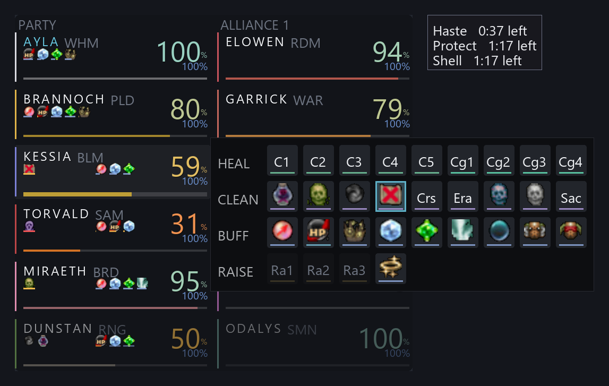
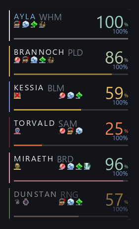
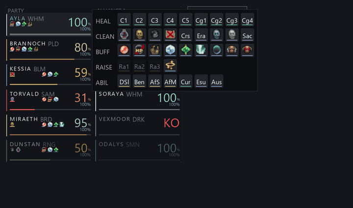
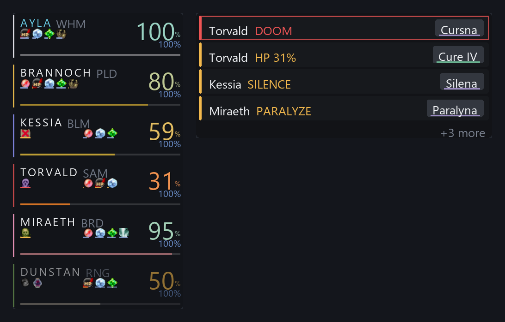
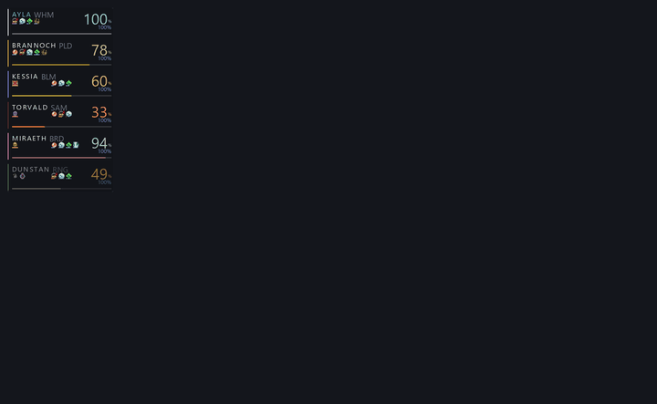
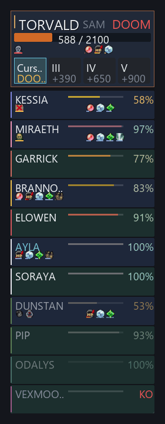
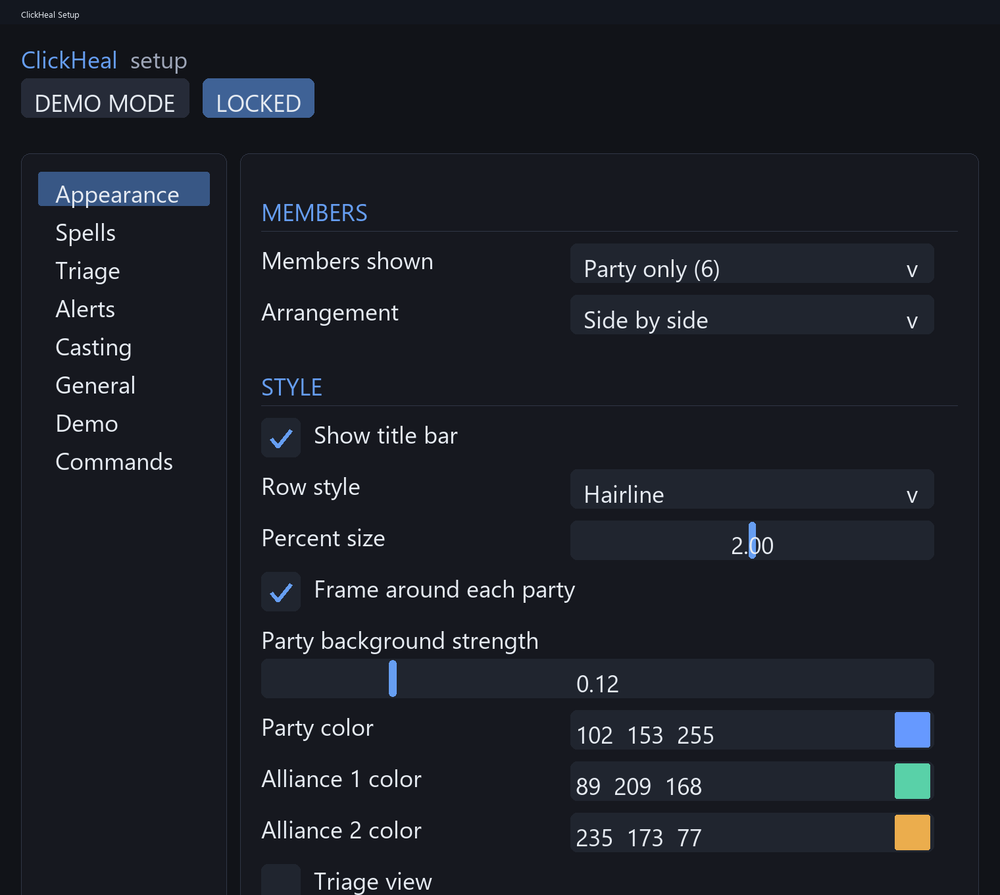
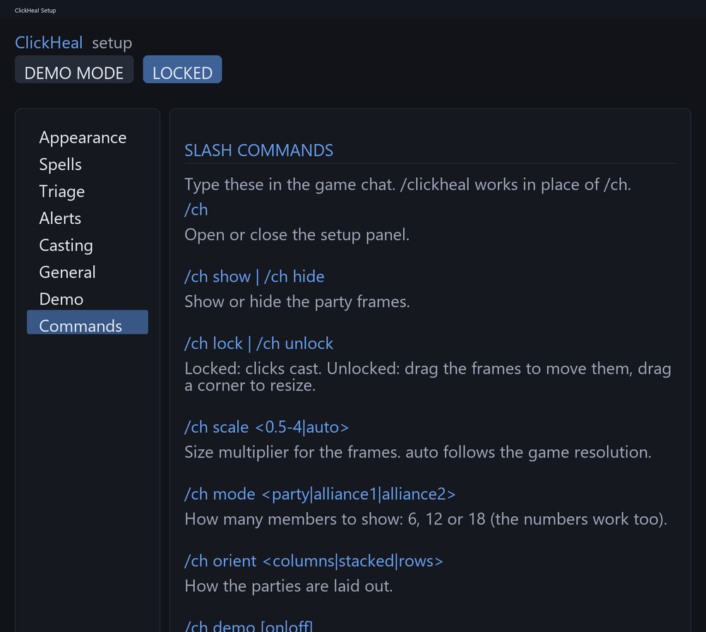

# ClickHeal

Click-to-heal party and alliance frames for **Final Fantasy XI** on **Ashita v4**. Hover a party member, click a spell, done. Built for healers, but any job can use it.



> **Heads up: CatsEyeXI.** CatsEyeXI only allows addons on its approved list, and ClickHeal is **not** on it. Do not load it on that server unless staff have approved it. It is intended for private servers (for example LandSandBoat with a normal Ashita v4 install). Clicking a spell sends a real cast to your real party, so treat it like any other automation addon.

> **About the pictures.** The images and GIFs below are renders made by ClickHeal's own drawing code (the same code that draws in game), with the game's own status icons, not in-game screenshots. Cure and raise tiles have no game icon, so they show short text.

## What it does

- **Party and alliance frames** for 6, 12 or 18 members, with HP, MP, job, distance and status effects.
- **Hover spell menu**: hover a member and a menu opens beside the row with that member's spells, grouped **HEAL / CLEAN / BUFF / RAISE**. One click casts it on them. No target switching, no macros.
- **Smart suggestions**: the spell a member needs is outlined (Cursna for Doom, Silena for Silence, Raise for a KO), and positions never move, so muscle memory works.
- **Alert bar** (optional): a separate window listing who needs help most, each with a one-click suggested spell. See [Alert bar](#alert-bar).
- **Triage view**: one big featured target (the member who needs help most) with one-click cure tiles, and everyone else in a compact list by priority.
- **Real status effects** (buffs and debuffs) with short tags, worst first. Hover for the full list.
- **Your layout**: columns, stacked or rows; solid or hairline look; any size, scaled to your resolution.
- **Demo mode**: a fake party to try layouts without a group. Demo members never cast.

## Tour

### Demo mode

Try it with `/ch demo on`. A fake party with changing HP and status effects, so you can set things up before you need them.



### Hover spell menu

Hover a member to open their menu, click a tile to cast. The menu follows your mouse from row to row, and stays open while you move onto it.



### Alert bar

An optional separate window (turn it on with **Show the alert bar** on the Alerts page) that lists whoever needs help right now, most urgent first, each with the spell that fixes it. Click the spell to cast it. It only suggests; nothing happens until you click.



- **What raises an alert:** a debuff you can cure (Doom, Petrify, Sleep and Terror first; then Silence, Paralysis and the minor ones), HP under your threshold, and KO'd members (Raise).
- **Order:** worst first, so Doom outranks a low-HP member who can still wait. A "+N more" line says how many are hidden.
- **Suggested spell:** the cure for that debuff, the strongest Cure you know for low HP, or Raise for a KO. It greys out with the reason (out of range, no MP, recast) when you can't cast it yet.
- **Critical alerts pulse** so they catch your eye; turn that off if you prefer.
- **Right click** an alert to hide it for 25 seconds.
- **Your choices:** pick which debuffs raise an alert, the low HP percentage, how many alerts show at once, and whether KOs alert at all. Drag the bar anywhere while the frames are unlocked.

### Layouts

`/ch orient columns | stacked | rows`, and `/ch mode party | alliance1 | alliance2`. The GIF cycles through party, alliance, 18 members, stacked, rows, the hairline look and triage.



### Triage

The featured member at the top (their worst status effect, HP and your cure tiles), then everyone else ordered by who needs help most. Members you can't reach (out of range, another zone) come after, and KO'd members are last.



### Setup panel

`/ch` opens it. Everything is a checkbox or a slider, with hints on hover. Colors for each party, text size, row height, bar styles, the solid or hairline look and more are all here.

| Appearance | Commands |
|---|---|
|  |  |

## Install

1. Copy the folder `addons/clickheal` into your Ashita install's `addons` folder so you have `Ashita/addons/clickheal/clickheal.lua`.
2. In game: `/addon load clickheal`
3. `/ch` opens the setup panel.

The frames start **locked** (clicks cast, frames stay put). `/ch unlock` lets you drag the frames and the alert bar, and drag a corner to resize. `/ch lock` when you are done. Clicks never cast while unlocked.

Settings are saved per character.

## Using it

- **Click a spell tile** in the hover menu to cast it on that member.
- **Right click** a heal for one tier down, **Shift+click** for one tier up (Cure IV: right click = Cure III, Shift = Cure V).
- Tiles show cooldown, a tint when you lack the MP, and grey out when the member is out of range or KO'd.
- **Your own row** also offers your job abilities (for example Divine Seal and Benediction for White Mage).
- **Spell order** is yours, the same for every member (Spells page in the setup panel).
- **Only what you can cast is offered.** The menu follows your main job, and your sub job at half its level. Spells above your level, or that you haven't learned yet (the game is asked), are left out. Turn on **Show spells I cannot use yet** on the Spells page to see them greyed out, with the reason when you hover ("Needs SCH 55", "Not learned yet"). They never cast.
- **Scholars and Red Mages** get their own default menus: Scholar has Cure, Regen, the cleanses, the storms and Raise, plus Light and Dark Arts, the Addendums and the stratagems; Red Mage has Cure, Haste, Refresh, Flurry, Phalanx, Stoneskin, the Enspells and the spikes, plus Convert, Composure and Chainspell.

### Status effects

ClickHeal reads other members' buffs and debuffs from, in order:

1. the game's party status packets (most accurate),
2. the game's party memory,
3. the chat log (fallback, for example "Torvald is poisoned").

It only reads. Check what is working with `/ch status`.

## Commands

`/ch` and `/clickheal` are the same.

| Command | What it does |
|---|---|
| `/ch` | Open or close the setup panel. |
| `/ch show` &nbsp;/&nbsp; `/ch hide` | Show or hide the party frames. |
| `/ch lock` &nbsp;/&nbsp; `/ch unlock` | Locked: clicks cast. Unlocked: drag the frames to move them, drag a corner to resize. |
| `/ch scale <0.5-4\|auto>` | Size multiplier for the frames. `auto` follows the game resolution. |
| `/ch mode <party\|alliance1\|alliance2>` | How many members to show: 6, 12 or 18 (the numbers work too). |
| `/ch orient <columns\|stacked\|rows>` | How the parties are laid out. |
| `/ch demo [on\|off]` | Demo mode: a fake party for trying layouts. It never casts. No argument switches it. |
| `/ch status` | Show what is switched on and where status effects come from. |
| `/ch reset confirm` | Put every setting back to its default. |
| `/ch apicheck` | List the game functions this install is missing. Include it in bug reports. |
| `/ch help` | Print this list in the chat log. |

## Not yet confirmed in game

ClickHeal is tested offline against stand-ins for Ashita and ImGui, and on a local LandSandBoat server. Some things have only been checked that way, so please report problems:

- Status effects from packets on a real party (`/ch status` shows the counts).
- Icon sharpness and the spell menu at unusual window sizes.
- Spell levels and availability come from public wikis; your server may differ.

If something looks wrong, run `/ch apicheck` and `/ch status` and include the output.

## For developers

You only need a Lua interpreter (5.1-5.4 or LuaJIT) for the tests; no game is needed.

```
sh tools/test.sh               # or .\tools\test.ps1
lua tests/run.lua              # unit and UI tests
lua tests/smoke_ashita.lua     # Ashita glue against stubs
lua tests/config_layout.lua    # setup panel layout checks
```

Preview renders (needs Python with Pillow):

```
lua tools/dump_draw.lua preview_json && python tools/preview.py preview_json preview_png
lua tools/dump_config.lua preview_config_json && python tools/preview_config.py preview_config_json preview_config_png
```

README media is regenerated with:

```
lua tools/dump_draw.lua media_json media
python tools/make_media.py media_json preview_config_png media
```

How it is put together:

```
addons/clickheal/
  clickheal.lua        Ashita entry: events, /ch commands, settings, per-frame glue
  ch/
    layout.lua         scaling and geometry (pure)
    spells.lua         spell definitions and presets
    frame.lua          builds everything one frame needs (shared by game, tests, previews)
    ui.lua             draws through a small gfx interface; never touches ImGui directly
    gfx_imgui.lua      in-game backend (Ashita ImGui)
    gfx_record.lua     recording backend for tests and previews
    configui.lua       the setup panel
    livebuffs.lua      status effects from party packets
    chatstatus.lua     status effects from the chat log (fallback)
    source_game.lua    real party data    source_demo.lua  fake party data
    commands.lua       the /ch commands (single list shared with the setup panel)
tests/                 unit, UI and layout tests
tools/                 preview and media renderers
```

The split is deliberate: `ui.lua` draws through `gfx`, so the same drawing code runs in the game (ImGui) and in the tests and previews (recorder). Only `gfx_imgui.lua`, `configui.lua` and `clickheal.lua` touch Ashita.
